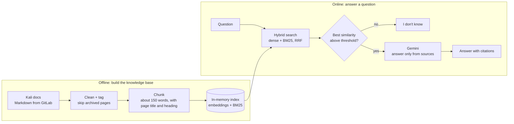

# Kali Troubleshooter: a grounded RAG assistant for Kali Linux

A Retrieval-Augmented Generation (RAG) system that answers Kali Linux troubleshooting questions using only the official Kali documentation. Every answer cites the pages it came from, and the system says "I don't know" when the docs don't cover the question.

> **Status:** retrieval and answer generation work, and a retrieval benchmark is in place. A held-out end-to-end evaluation of the generated answers is still in progress (see [Roadmap](#roadmap)).

<!-- Add a screenshot of the UI here:  -->

---

## Why this project exists

Kali Linux is a rolling-release distribution with frequent breaking updates and unusual configurations (monitor-mode drivers, PostgreSQL for Metasploit, VM guest tools, APT signing keys). Troubleshooting advice is scattered across docs, forums, and outdated blog posts, and general-purpose LLMs often suggest fixes written for Ubuntu that break Kali.

This project grounds an LLM in the official Kali docs so that answers are traceable and checkable.

## Features

- **Hybrid retrieval:** combines semantic search (sentence embeddings) with keyword search (BM25) using reciprocal rank fusion, so rare terms like `msfdb`, `EXPKEYSIG`, or `KeX` are not lost.
- **Grounded answers:** Gemini is instructed to answer only from the retrieved sources, to cite them, and to refuse when the sources are insufficient.
- **Out-of-scope refusal:** a similarity threshold rejects unrelated questions before the LLM is called.
- **Measured, not guessed:** a test harness scores retrieval accuracy, false refusals, and correct refusals, and every experiment is saved in `results/`.
- **Streamlit chat UI** with example questions and an expandable "Sources used" section.

## How it works



| Stage | Implementation |
|---|---|
| Source data | Official Kali docs (`kali-docs` repository on GitLab), Markdown files |
| Chunking | Paragraphs packed into chunks of about 150 words; each chunk is prefixed with `folder \| page title \| section heading` |
| Dense search | `sentence-transformers` model `all-MiniLM-L6-v2`, cosine similarity |
| Keyword search | `rank-bm25` (BM25Okapi) |
| Fusion | Reciprocal rank fusion (k = 60) over the top 50 of each ranking; results de-duplicated by page |
| Refusal gate | If the best dense similarity is below `THRESHOLD` (0.35), the system refuses without calling the LLM |
| Generation | Google Gemini through the `google-genai` SDK, temperature 0, grounded system prompt with numbered citations |
| UI | Streamlit |

## Project structure

```
kali-rag/
├── app.py                 Streamlit chat interface
├── ask.py                 Retrieval + Gemini answer generation (CLI)
├── retrieval.py           Chunking, indexing, hybrid search, THRESHOLD
├── eval.py                Retrieval benchmark and scoring
├── find_folder.py         Helper: find real doc folder names for test labels
├── .streamlit/config.toml UI theme
├── results/               Saved output of every evaluation run
├── old/                   Superseded early prototype
├── data/raw/              Kali docs (not committed; see setup)
├── requirements.txt
└── .env                   Your API key (not committed)
```

## Getting started

**Requirements:** Python 3.10 or newer (developed on Python 3.13), Git, and a Gemini API key from [Google AI Studio](https://aistudio.google.com/).

```powershell
# 1. Clone this repository and enter it
git clone <your-repo-url>
cd kali-rag

# 2. Create and activate a virtual environment
python -m venv venv
venv\Scripts\activate            # macOS/Linux: source venv/bin/activate

# 3. Install dependencies
pip install -r requirements.txt

# 4. Download the Kali docs (the data is not stored in this repo)
git clone https://gitlab.com/kalilinux/documentation/kali-docs.git data/raw/kali-docs

# 5. Add your API key
#    Create a file named .env containing one line (no quotes, no spaces around =):
#    GEMINI_API_KEY=your-key-here
```

Never commit your API key. `.env` is listed in `.gitignore`.

### Run the chat UI

```powershell
streamlit run app.py
```

The first start takes a minute or two while the embedding model loads and the chunks are embedded. Later questions are fast.

### Run in the terminal

```powershell
python ask.py
```

### Choose the Gemini model

Model names change over time. To see what your key can use, and to select one:

```powershell
python -c "from google import genai; [print(m.name) for m in genai.Client().models.list()]"
$env:GEMINI_MODEL="model-name-here"
```

## Evaluation

`eval.py` runs a labeled test set and prints one status per question:

| Status | Meaning |
|---|---|
| `PASS` | A correct page is ranked first and the question was accepted |
| `TOP3` | A correct page is in the top 3, but not first |
| `FALSE_REFUSAL` | The right page was found, but the score was below the threshold |
| `WRONG_RETRIEVAL` | No correct page was retrieved |
| `PASS / FAIL \| should refuse` | Out-of-scope questions that must be refused |

The test set has **56 in-scope questions** (mixed: some copy page titles, most are written as user symptoms such as "apt says missing key" or "my live USB loses changes after reboot") and **13 out-of-scope questions** (unrelated topics, plus technical but non-Kali ones like "my ubuntu server will not boot"). Questions can list several acceptable pages when more than one genuinely answers them.

```powershell
python eval.py | Tee-Object results/results_new.txt
```

### Results so far

| Configuration | Top-1 | Top-3 | Correct refusals |
|---|---|---|---|
| Hybrid search, section-level chunks (717 chunks) | 44/56 | 50/56 | 12/13 |
| Hybrid search, small chunks with titles (1,724 chunks) | 43/56 | 51/56 | 11/13 |
| **Hybrid search, small chunks, final configuration** | **43/56** | **51/56** | **12/13** |
| Same, plus cross-encoder reranker (`ms-marco-MiniLM-L-6-v2`) | 34/56 | 48/56 | 12/13 |

What the experiments showed:

- Adding BM25 to dense search fixed questions that depend on rare keywords (for example the NetHunter KeX question).
- Smaller chunks did not clearly improve accuracy on this test set: top-1 was flat and top-3 changed by one question, which is within noise.
- The off-the-shelf reranker made results **worse** (top-1 dropped from 43 to 34), so it is disabled. It was trained on general web search and appears to favour broad overview pages over specific ones.

**Caveat:** these numbers come from the development set, which was also used to choose the threshold and to fix labels, so they are optimistic. A fresh held-out question set and a manual grading of generated answers (correctness, groundedness, citation accuracy) are planned.

## Known limitations

- **Vocabulary mismatch:** users and docs describe the same thing differently. "wifi card not detected" retrieves graphics-card pages instead of wireless-driver pages, because the small embedding model treats "card" loosely.
- **The refusal threshold overlaps:** the lowest-scoring correct question (about 0.38) is close to the highest-scoring out-of-scope one (0.39 to 0.41), so no single cutoff separates them perfectly. The prompt's "I don't know" rule is a second line of defence.
- **Confusable pages:** similar pages such as VirtualBox host vs guest, or two near-duplicate Raspberry Pi LUKS guides, are sometimes swapped.
- **Single source:** only the official docs are indexed. Problems the docs do not cover (for example generic "tool crashes after an update") cannot be answered.
- **Not a diagnostic tool:** the assistant reads documentation. It does not inspect or change your system.

## Roadmap

- [ ] Held-out evaluation set and manual grading of generated answers
- [ ] Cache embeddings on disk for fast startup
- [ ] More sources: man pages and `--help` output, release notes, resolved bug reports
- [ ] Better refusal signal (for example an LLM relevance check) and a stronger embedding model
- [ ] Show retrieved text and links to the original doc pages in the UI
- [ ] Stretch goal: an agent that diagnoses a live Kali VM with read-only commands, uses this system as its documentation tool, and asks for approval before any change

## Scope and responsible use

This assistant helps fix problems with the Kali Linux system itself: installation, packages, services, drivers, virtualization. It answers from documentation and is not intended for planning or carrying out attacks.

## Acknowledgements

- [Kali Linux documentation](https://www.kali.org/docs/) by the Kali Linux team. This repository does not include or redistribute the docs; check the upstream repository for its licence terms.
- [sentence-transformers](https://www.sbert.net/), [rank-bm25](https://github.com/dorianbrown/rank_bm25), [Streamlit](https://streamlit.io/), and [Google Gemini](https://ai.google.dev/).

## Author

~ Samudyatha · BCA, 5th semester · Generative AI coursework project

